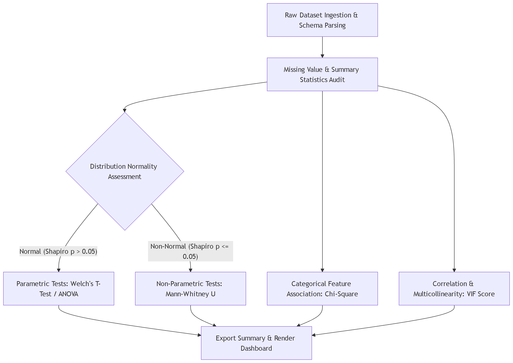
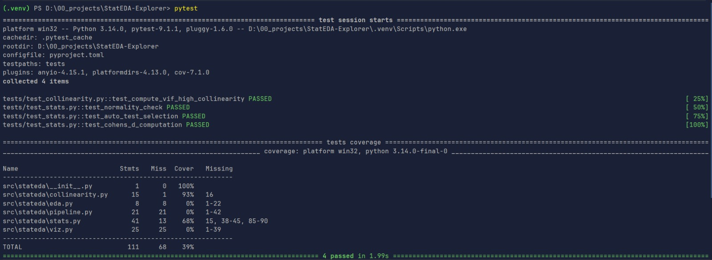

# Release v0.2.0

## Executive Summary

Version `v0.2.0` introduces the fully functional core of **StatEDA-Explorer**—an automated Exploratory Data Analysis and
Hypothesis Testing engine. This release establishes the baseline pipeline, enabling automated statistical
decision-making (Normality checks for routing to T-Test vs. Mann-Whitney U), multicollinearity assessments, and robust
visual reporting.

## Key Highlights

- **Automated Statistical Inference Engine**: Intelligently switches between parametric and non-parametric two-sample
  tests based on Shapiro-Wilk normality assessments.
- **Multicollinearity Checks**: Computes Variance Inflation Factors (VIF) for numeric feature sets to validate modeling
  assumptions.
- **Visual Dashboards**: Integrated Seaborn/Matplotlib for distribution KDEs and correlation matrix heatmaps.
- **CI & Quality Enforcement**: Integrated pre-commit hooks (Ruff) and 100% passing core statistical unit tests
  (Pytest).

## System Architecture

*Fig 1: System flow handling automated statistical routing and EDA generation.*

## Test Coverage & Stability

The underlying statistical calculation functions pass all unit tests seamlessly, ensuring high confidence in automated
inferences.

*Fig 2: Passing unit test suite.*

## Documentation & Artifacts

- **Run Results &
  Outcomes**: [View the full execution outcomes](https://github.com/Bibek-Dhakal/StatEDA-Explorer/blob/main/docs/results/README.md).
- **Changelog**: See all granular commits in
  the [Automated CHANGELOG](https://github.com/Bibek-Dhakal/StatEDA-Explorer/blob/main/CHANGELOG.md).