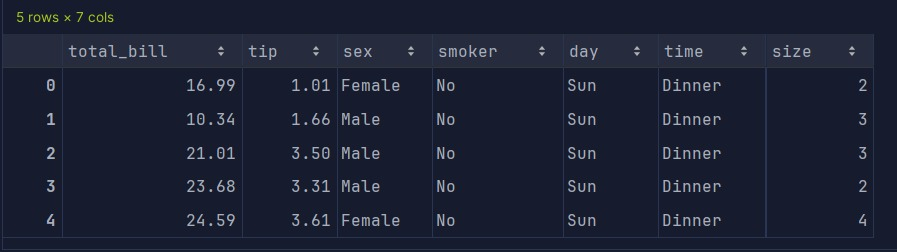
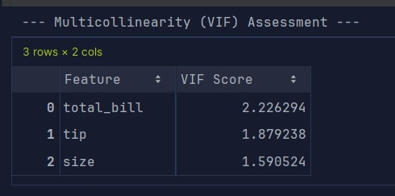
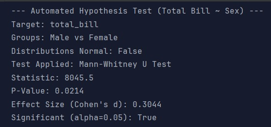
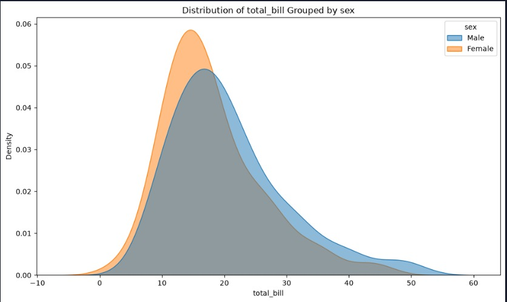
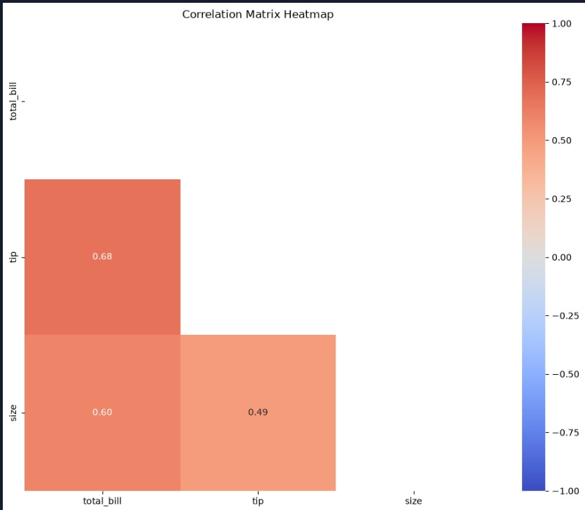

# StatEDA-Explorer: Run Results & Outcomes

This document captures the baseline execution results and visual outcomes generated by the StatEDA-Explorer pipeline on
sample datasets.

## Dataset Profiling: Seaborn `tips`

The following results demonstrate the automated pipeline analyzing the standard `tips` dataset.

### 1. Dataset Preview

A quick look at the loaded categorical and numerical features before processing:

### 2. Multicollinearity (VIF) Assessment

The engine automatically computed Variance Inflation Factors to check for multicollinearity among numeric features. All
features are well below the threshold of 5.0, indicating low multicollinearity.

### 3. Automated Hypothesis Testing

**Goal**: Determine if the `total_bill` significantly differs between `Male` and `Female` groups.

**Engine Decision**: The engine detected non-normal distributions (Shapiro-Wilk $p \le 0.05$) and automatically selected
the **Mann-Whitney U Test** instead of a Parametric T-Test.

### 4. Visualizations

#### Target Distribution Analysis

The overlapping KDE plot visibly confirms the non-normal skew observed by the statistical engine.

#### Correlation Matrix

